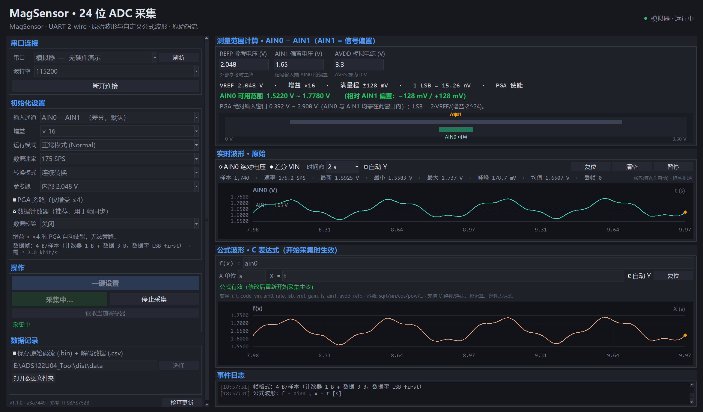

# MagSensor

MagSensor 是面向 **TI ADS122U04**（24 位、4 通道、UART 接口 ΔΣ ADC）的 Windows 图形化采集与分析软件。
默认测量 **AIN0 − AIN1** 差分信号，并把 **AIN1 视为信号的直流偏置**，可实时换算 AIN0 绝对电压、显示原始波形和可自定义的公式波形，并保存原始码流与计算结果。

版本号由 **git tag** 生成；发布包通过 GitHub Release 分发，程序启动时检查更新，发现新 tag 后弹窗强制更新并显示 **tag commit**。



---

## 1. 主要功能

- 串口枚举、刷新、连接/断开；波特率 9600 ~ 115200（8-N-1，ADC 自动识别波特率）
- 图形化配置全部 5 个寄存器：
  - 输入通道 MUX、增益（×1 ~ ×128）、PGA 旁路
  - 正常 / Turbo 模式、数据速率、连续 / 单次转换
  - 内部 2.048 V / 外部 REFP-REFN / AVDD 参考
  - 数据计数器 DCNT、数据校验（关闭 / 反码 / CRC-16）
- **一键设置**：自动发 `RESET` → 写入全部寄存器 → 逐寄存器回读校验
- 自动数据读取模式（AUTO=1）流式采集，逐帧解析：
  - 24 位二进制补码，数据字 LSB first
  - 可选 1 字节数据计数器（用于帧同步、漏帧检测）
  - 可选反码校验 / CRC-16-CCITT 校验
  - 检测到帧边界错位时自动重新同步
- **原始码流保存**（`.bin`，设备 TX 原始字节）+ **解码数据**（`.csv`）+ **配置快照**（`.json`）
- **双波形显示**：
  - 原始波形：AIN0 绝对电压（`AIN0 = VIN + AIN1`）或差分电压 `VIN`
  - **公式波形**：每个样本的波形值由用户输入的 C 表达式 `f(x)` 计算；横轴数值由可编辑的 X 表达式计算，单位可自定义
  - 时间窗 0.5 s ~ 30 s / 全部，自动 Y 缩放，暂停显示，清空显示缓冲，上下波形可拖动分隔条
  - **Y 轴交互**：关闭“自动 Y”后，鼠标滚轮在波形上缩放 Y 轴
  - **框选放大**：在任一波形上按住左键拖出矩形，放大所选 X/Y 区间；每栏都有“复位”
  - 帧率、最新/最小/最大/峰峰值/均值、丢帧与错误统计
- **测量范围计算**：输入 REFP、AIN1（偏置）、AVDD，实时计算 VREF、满量程、1 LSB、PGA 绝对输入窗口、AIN0 可用范围，并给出图形化范围条
- 内置**模拟器**（无硬件演示），用于检查界面、波形和文件保存
- **git tag 版本号 + GitHub Release 自动更新**：
  - 版本/commit 在建包时从 git tag 注入
  - 启动检查 `latest.json`，发现新 tag 时模态弹窗（显示 tag、commit SHA、提交说明、日期、发布说明）
  - 强制更新：只能“立即更新”或“退出程序”，不能稍后
  - 下载后 SHA-256 校验、更新助手替换、自动重启、启动健康检查与 `.bak` 回滚
- 手动“检查更新”按钮；离线时自动跳过检查，不影响采集
- 高 DPI 自适应、深色界面、设置自动保存

---

## 2. 文件与路径

```
E:\ADS122U04_Tool\
├─ src\
│  ├─ ads122u04_tool.py        ← 主程序源码
│  ├─ formula.py               ← C 表达式解析/求值（公式波形）
│  └─ updater.py               ← 更新检查 / 下载 / 自替换 / 健康检查
├─ tools\build.py              ← 从 git tag 生成版本并打包
├─ .github\workflows\release.yml ← tag 触发的 Release 构建
├─ build.cmd                   ← 一键打包包装器
├─ _tests\fake_serial_test.py  ← 无硬件协议/采集测试
├─ docs\
│  ├─ screenshot.png
│  └─ ADS122U04_SBAS752B_datasheet.pdf
├─ icon.ico
├─ data\                       ← 默认数据保存目录
├─ ADS122U04_ADC_Tool.exe      ← 历史本地 exe（旧版本，发布版以 Release 资产为准）
├─ build\                      ← 生成，已被 .gitignore 忽略
└─ dist\                       ← 生成，包含 MagSensor.exe / latest.json / release_notes.md
```

- 数据默认保存在 **exe 所在目录的 `data` 子目录**；可在界面中改选其他目录。
- 串口、波特率、配置、范围参数、公式等保存在：
  `%APPDATA%\ADS122U04_Tool\settings.json`
  （内部目录名保留 `ADS122U04_Tool` 以兼容已有安装/设置；界面和程序名为 MagSensor）
- 更新日志 / 启动标记 / 下载缓存：`%LOCALAPPDATA%\ADS122U04_Tool\`
- 删除 settings JSON 即可恢复出厂默认界面参数（不影响数据文件）。
- 仓库按 tag 发布 exe；建议不要把 exe 和采集数据文件提交到 git，统一从 GitHub Releases 下载。

---

## 3. 快速开始

### 3.1 接线

| USB-UART 模块 | ADS122U04 板 |
|---|---|
| TXD | RXD |
| RXD | TXD |
| GND | DGND |
| 3.3 V（按板子要求） | DVDD / 供电 |

- 逻辑电平按 3.3 V 设计；若 USB-UART 为 5 V，请做电平转换。UART 为 2 线（TXD/RXD），无需时钟。
- 模拟部分供电、REFP/REFN、AIN0/AIN1 接线按实际板卡与数据手册。
- AIN0 接被测信号；AIN1 接该信号的直流偏置。

### 3.2 采集步骤

1. 打开 `MagSensor.exe`（或下载 GitHub Release 中的最新 MagSensor 版本）。
2. “串口”选择对应 COM 口，“波特率”默认 115200（也支持 9600 ~ 115200），点击 **连接串口**。
3. 在“测量范围计算”中填写：
   - **REFP**：参考电压（内部参考时此值不参与换算；外部参考时填写 `V(REFP) − V(REFN)`，程序默认 REFN = AVSS = 0 V）
   - **AIN1**：信号偏置电压（AIN0 的直流偏置）
   - **AVDD**：模拟电源电压
4. 在“初始化设置”中选择通道（默认 **AIN0 − AIN1**）、增益、数据速率、参考源等。
5. 点击 **一键设置**。日志中应出现：
   - `[配置] 00h=.. ...`
   - `回读 00h=.. ✓ ...`，状态显示 **初始化完成 · 回读 5/5 一致**
6. 勾选“保存原始码流 + 解码数据”，选择数据目录。
7. （可选）在“公式波形”栏设置：
   - `f(x)`：波形值公式，默认 `ain0`
   - `X 单位`：横轴单位标签，默认 `s`
   - `X =`：横轴数值公式，默认 `t`
   公式语法见第 6 节。公式在开始采集时生效，采集期间锁定。
8. 点击 **开始采集**。两栏波形与统计开始刷新。
9. 点击 **停止采集**。原始 `.bin`、`.csv`、`.json` 会显示在日志中，可点击 **打开数据文件夹**。

> “一键设置”只写配置、不启动转换；“开始采集”会重新复位并写入同一套配置后启动，确保帧边界从第一帧开始对齐。

---

## 4. 初始化选项说明

| 选项 | 说明 |
|---|---|
| 输入通道 | MUX[3:0]。默认 `AIN0 − AIN1`。单端 `AINx − AVSS` 会自动旁路 PGA 且增益限制为 1/2/4；监测/短接模式下增益无效 |
| 增益 | ×1 ~ ×128。增益 > ×4 时 PGA 自动使能，不能旁路 |
| 运行模式 | 正常模式 20 ~ 1000 SPS；Turbo 模式 40 ~ 2000 SPS |
| 数据速率 | 由 DR[2:0] 决定，随运行模式变化 |
| 转换模式 | 连续转换 / 单次转换。单次模式下程序在每帧接收后再次发 `START/SYNC`，形成受转换时间节拍的连续采集 |
| 参考源 | 内部 2.048 V / 外部 REFP-REFN / 模拟电源 AVDD |
| PGA 旁路 | 仅增益 ≤ ×4 可选。旁路后绝对输入范围扩大到 AVSS−0.1 V ~ AVDD+0.1 V |
| 数据计数器 | 推荐开启。每帧多 1 字节计数，用作帧同步与漏帧检测 |
| 数据校验 | 关闭 / 反码 / CRC-16。CRC 覆盖计数器和 3 字节数据 |

**数据输出模式固定为自动输出（AUTO = 1）**。软件不使用 RDATA 轮询方式。

---

## 5. 量程计算

### 5.1 基本公式

- 参考电压 `VREF`：
  - 内部参考：2.048 V
  - 外部参考：`REFP − REFN`（本程序按 REFN = 0 V 计算，取输入框中的 REFP）
  - AVDD 参考：`AVDD − AVSS`（AVSS = 0 V）
- 满量程：`FS = VREF / Gain`
- 1 个码：`1 LSB = 2·VREF / (Gain·2^24) = VREF / (Gain·2^23)`
- 差分输入：`VIN = AIN0 − AIN1 = code × LSB`
- AIN0 绝对电压：`AIN0 = VIN + AIN1`

### 5.2 PGA 绝对输入窗口

数据手册 Equation 6 / 7：

- Gain ≤ 4（PGA 使能）：`AVSS + 0.2 V ≤ VAINP, VAINN ≤ AVDD − 0.2 V`
- Gain > 4：`AVSS + 0.2 + |VINMAX|·(Gain−4)/8 ≤ VAINP, VAINN ≤ AVDD − 0.2 − |VINMAX|·(Gain−4)/8`
- PGA 旁路（仅 Gain ≤ 4）：`AVSS − 0.1 V ~ AVDD + 0.1 V`

程序取 `VINMAX = FS`（最保守情况）来画绝对输入窗口，因此实际小信号时可用范围可能更宽。

### 5.3 AIN0 可用范围

```
AIN0 可用范围 = [AIN1 − FS, AIN1 + FS] ∩ PGA 绝对输入窗口
```

同时要求 AIN1 本身落在绝对输入窗口内。界面第二行显示最终结果，范围条显示：

- 灰色：PGA 绝对输入窗口
- 绿色：AIN0 可用范围
- 橙色标记：AIN1 偏置

若显示 **范围不可用**，程序会提示原因（偏置超窗、窗口为空、监控模式等）。

> 通道不是 AIN0−AIN1 时，量程按 AIN0−AIN1 估算，仅作参考。
> 选择反向通道 AIN1−AIN0 时，波形按 `AIN0 = AIN1 − VIN` 显示。

---

## 6. 公式波形与 C 表达式

### 6.1 两栏波形

- **实时波形 · 原始**：AIN0 绝对电压或差分 VIN，横轴为自开始采集起的绝对时间 `t (s)`。
- **公式波形**：每个样本的纵轴值由 `f(x)` 计算，横轴数值由 `X =` 计算。两栏共用“时间窗”的样本范围，但公式栏的横轴单位/数值是自定义的。
- 公式在点击“开始采集”时编译并生效；采集期间公式和 X 输入框锁定；停止后可以修改，**修改后需要重新开始采集**才会用新公式计算和写入 CSV。

### 6.2 公式变量

| 变量 | 类型 | 含义 |
|---|---|---|
| `i` | int | 样本序号（从 0 开始） |
| `t` | float | 名义时间（秒） = `i / rate` |
| `code` | int | 24 位有符号原始码 |
| `vin` | float | 差分电压 = `code × lsb` |
| `ain0` | float | AIN0 绝对电压；AIN0−AIN1 通道为 `vin + ain1`，反向通道为 `ain1 - vin`，其他通道为 NaN |
| `rate` | float | 当前数据速率（SPS） |
| `lsb` | float | 1 LSB 电压 |
| `vref` | float | 实际参考电压 |
| `gain` | int | 有效增益 |
| `fs` | float | 满量程（VREF / 增益） |
| `ain1` | float | AIN1 偏置 |
| `avdd` | float | 模拟电源 |
| `refp` | float | 参考电压输入值 |

常量：`M_PI`、`M_E`、`NAN`、`INFINITY`。

### 6.3 C 表达式支持范围

语法和 C 风格一致（表达式子集，不是完整 C 编译器）：

- 数字：十进制、十六进制 `0x..`、八进制 `010`、浮点/科学计数法、`f/F/l/L/u/U` 后缀
- 运算符（按 C 优先级）：`+ - * / % << >> < <= > >= == != & ^ | && || ?:`
- 一元：`+ - ! ~`；括号
- 类型转换：`(int) (long) (unsigned) (short) (char) (float) (double)`
- C 整数语义：两个整数相除/取余使用整数运算（`1/2 == 0`），要浮点结果请写 `1.0/2`
- `&&`/`||`/`?:` 短路；比较和逻辑结果为 0/1
- 数学函数：`fabs sqrt sin cos tan asin acos atan atan2 exp log log10 pow floor ceil round trunc fmod fmin fmax hypot sinh cosh tanh`
- 不支持赋值、数组、指针、语句、循环、自定义函数；非法表达式会在“开始采集”前被拒绝，并显示错误

示例：

| f(x) | X | 说明 |
|---|---|---|
| `ain0` | `t` | 默认：绝对 AIN0 随时间 |
| `(ain0 - 1.65) * 1000` | `t` | 相对偏置的毫伏值 |
| `sin(2*M_PI*50*t)` | `t` | 50 Hz 合成/参考信号 |
| `fabs(vin)` | `i` | 差分绝对值，横轴为样本序号 |
| `sqrt(vin*vin)` | `t*1000` | 横轴单位 `ms` |

### 6.4 X 轴单位与数值

- **X 单位**：只作为横轴标签（如 `s`、`ms`、`sample`、`Hz`），程序不会自动换算数值。
- **X 值公式**：真正决定横轴数值，例如 `t*1000` 配合单位 `ms`，或 `i` 配合单位 `sample`。
- 公式栏的 X 轴数值和曲线按样本顺序绘制；如果 X 表达式不是单调的，曲线仍按采样顺序连接，框选按 X 范围选择样本。
- 原始波形的 X 轴单位固定为秒，不从公式栏借用。

### 6.5 波形交互

- **滚轮缩放 Y**：只有在对应波形的“自动 Y”未勾选时生效；以鼠标位置为中心缩放 Y 轴。滚轮在自动模式下不改变视图，请先取消“自动 Y”。
- **框选放大**：在任一栏按住左键拖动，释放后放大到所选矩形；该栏自动关闭“自动 Y”，X 视图固定到所选样本/数值区间，新数据不会把视图滚走。
- **复位**：恢复该栏的自动 Y 和滚动时间窗。
- **暂停 / 清空**：原始栏工具栏中的按钮同时作用于两栏（暂停自动重绘 / 清空显示缓冲和统计）。
- 两栏之间的分隔条可以上下拖动；日志区域在底部。

### 6.6 计算数据保存

CSV 新增：

| 列 | 含义 |
|---|---|
| `x_value` | 该样本的 X 值公式结果 |
| `formula_value` | 该样本的 f(x) 结果 |

- 任一项为 NaN/Inf 时写空，并在状态统计中累计“公式错误”。
- `.json` 配置快照包含 `formula`、`x_formula`、`x_unit` 和公式上下文（LSB、VIN、增益等）。
- 原始 `.bin` 不变，仍为设备 TX 原始字节流。

---

## 7. 数据帧格式与文件

### 7.1 自动输出帧

自动数据输出模式没有帧头，数据字 **LSB first**：

```
DCNT=1, 校验关闭:  [CNT][D0][D1][D2]                    4 字节
DCNT=0, 校验关闭:  [D0][D1][D2]                          3 字节
反码校验 (CRC=01): [CNT][D0][D1][D2][~CNT][~D0][~D1][~D2]  8 字节
CRC-16 (CRC=10):   [CNT][D0][D1][D2][CRC0][CRC1]         6 字节
```

- 24 位数据：`code = D0 | (D1 << 8) | (D2 << 16)`，最高位为符号位（二进制补码）。
- CRC：CRC-16-CCITT，多项式 `0x1021`，初值 `0xFFFF`，覆盖计数器 + 数据字节。
- 计数器每完成一次转换加 1，0xFF 后回绕。
- 程序默认 **DCNT=1、校验关闭**，即 4 字节/帧。

### 7.2 文件说明

每次“开始采集”会生成 3 个文件（文件名带毫秒时间戳）：

| 文件 | 内容 |
|---|---|
| `MagSensor_YYYYMMDD_HHMMSS_mmm_raw.bin` | 设备 TX 的**原始字节流**（从 START 后开始，无帧头、无附加信息） |
| `MagSensor_YYYYMMDD_HHMMSS_mmm_samples.csv` | 解码后的逐样本数据 |
| `MagSensor_YYYYMMDD_HHMMSS_mmm_config.json` | 端口、寄存器值、帧格式、量程参数快照 |

CSV 列：

| 列 | 含义 |
|---|---|
| `index` | 样本序号（从 0 开始） |
| `t_s` | 名义采样时间 = index / 数据速率 |
| `host_time_s` | 主机接收时间（从开始采集算起，受 USB 批量读取影响，可能有抖动） |
| `counter` | 数据计数器（未开启时为空） |
| `code` | 有符号 24 位原始码 |
| `vin_V` | 差分电压 = code × LSB |
| `ain0_V` | AIN0 绝对电压：AIN0−AIN1 通道为 `vin_V + AIN1`；反向通道 AIN1−AIN0 为 `AIN1 − vin_V`；其他通道留空 |
| `x_value` | 公式波形横轴值（X 表达式结果） |
| `formula_value` | 公式波形纵轴值（f(x) 结果） |

> `.bin` 是真正的“原始码流”；`.csv` 便于 Excel/MATLAB/Python 直接分析。
> 停止采集可能切断最后一帧，因此 `.bin` 末尾可能残留不足一帧的字节，解析时忽略即可。

---

## 8. 协议要点

### 8.1 命令

每条命令前都必须先发同步字 `0x55`（ADC 同时借此自动识别波特率）。所有字节 8-N-1、LSB first。

| 命令 | 字节 | 说明 |
|---|---|---|
| 同步字 | `0x55` | 每条命令前必须发送 |
| RESET | `0x06` | 复位，等待 ≥ 80 µs 再发下一条命令 |
| START/SYNC | `0x08` | 启动 / 重新启动转换 |
| POWERDOWN | `0x02` | 完成当前转换后进入掉电 |
| RDATA | `0x10` | 读取最近转换结果（本程序不使用） |
| RREG | `0x20 \| (addr<<1)` | 读寄存器 |
| WREG | `0x40 \| (addr<<1)` + data | 写寄存器 |

### 8.2 寄存器

| 地址 | 位定义 |
|---|---|
| `00h` | MUX[7:4] · GAIN[3:1] · PGA_BYPASS[0] |
| `01h` | DR[7:5] · MODE[4] · CM[3] · VREF[2:1] · TS[0] |
| `02h` | DRDY[7](只读) · DCNT[6] · CRC[5:4] · BCS[3] · IDAC[2:0] |
| `03h` | I1MUX[7:5] · I2MUX[4:2] · 0 · AUTO[0] |
| `04h` | GPIO2DIR · GPIO1DIR · GPIO0DIR · GPIO2SEL · GPIO2DAT · GPIO1DAT · GPIO0DAT |

程序每次写全部 5 个寄存器，并逐位回读校验。

### 8.3 波特率与带宽

- 器件 UART 支持 **2 ~ 120 kBaud**；本程序提供 9600 / 19200 / 38400 / 57600 / 115200。
- 每帧在线上需要 `帧长 × 10 bit`。所需带宽：

```
所需 bit/s = 帧长(字节) × 10 × 数据速率(SPS)
```

| 数据速率 | 4 字节/帧 | 6 字节/帧（CRC/反码） |
|---|---|---|
| 1000 SPS | 40 kbit/s | 60 kbit/s |
| 2000 SPS | 80 kbit/s | **120 kbit/s（超过 115200）** |

- 若超过当前波特率，界面会显示“⚠ 超过当前波特率”，请降低速率或关闭 CRC/反码/计数器。
- 自动输出模式下，主机在设备发送数据期间发命令可能造成冲突；程序停止时发送 POWERDOWN，并在开始采集前重新 RESET + 配置。高数据率下若停止后数据仍在继续，可再点一次“停止采集”。

---

## 9. 自动更新与版本发布

### 9.1 版本号来源

- tag 规范：`V1.2.3`（也接受小写 `v1.2.3`）。
- `tools/build.py` 在打包时执行 `git describe --tags`，把 `version / tag / commit / tag commit message` 写入 `build_info.json`，同时生成 Windows 版本资源。
- exe 内显示当前版本和 commit 短哈希；标题、页脚、更新弹窗都使用这份信息。
- 没有 tag 的本地构建标记为开发构建，**跳过启动更新检查**，避免开发时被强制更新打断。

### 9.2 发布流程

1. 提交并推送应用代码到当前分支（本仓库为 `master`）：
   ```bat
   git push origin master
   ```
2. 打 annotated tag，把发布说明写进 tag：
   ```bat
   git tag -a V1.1.0 -m "MagSensor：公式波形、Y 轴缩放/框选、MagSensor 品牌"
   git push origin V1.1.0
   ```
3. GitHub Actions（`.github/workflows/release.yml`）在 tag 上执行：
   - `python tools/build.py --release`
   - 构建 `dist/MagSensor.exe`
   - 生成 `dist/latest.json`（含 tag、commit、SHA-256、大小、下载 URL、强制标志）
   - 创建 GitHub Release 并上传两个文件
4. 客户端启动时读取：
   ```
   https://github.com/SolcheYang/ADS122U04IRTER_Driver/releases/latest/download/latest.json
   ```
   与当前版本比较；有新版本则弹窗。

> **首次升级注意：** `v1.0.0` 的 exe 没有更新器。需要手动安装一次 `V1.0.1` 发布包；从 `V1.0.1` 开始，后续 tag（包括 MagSensor 版本）会自动提示并强制更新。MagSensor 版本的 Release 资产名改为 `MagSensor.exe`，旧客户端会按清单 URL 下载并替换。
>
> 工作流文件必须在被打 tag 的提交里；先提交/推送工作流，再打新 tag。
> 当前 GitHub 默认分支是 `main`（只有 LICENSE/README），应用代码在 `master`；建议把 `master` 设为默认分支或合并，避免首页/文档显示不一致。

### 9.3 强制更新弹窗

程序启动后会在后台检查更新，不阻塞界面。发现新 tag 时：

- 弹出模态窗口，主界面不可操作
- 显示当前版本 → 最新 tag / 版本
- 显示 **tag commit**：短 SHA、完整 SHA、提交说明、提交时间
- 显示发布说明和下载大小
- 按钮只有 **立即更新** 和 **退出程序**；没有“稍后”
- 下载失败可“重试更新”或“手动下载”；关闭窗口等于退出程序

### 9.4 更新执行过程

1. 下载到 `%LOCALAPPDATA%\ADS122U04_Tool\updates\...`
2. 校验文件大小与 `latest.json` 中的 SHA-256
3. 启动新版本 exe 的 `--apply-update` 模式
4. 等待旧进程以及 PyInstaller onefile 的 bootloader 父进程退出
5. 备份旧 exe 为 `MagSensor.exe.bak`，替换为下载的新 exe
6. 启动新 exe；新 exe 写 `startup.json` 启动标记
7. 更新助手确认新版本成功启动；否则恢复 `.bak`

日志：`%LOCALAPPDATA%\ADS122U04_Tool\update.log`
手动回滚：把同目录的 `MagSensor.exe.bak` 改回实际的目标文件名（新安装为 `MagSensor.exe`；旧安装可能仍是 `ADS122U04_ADC_Tool.exe`）。

正式发布前建议在测试机用坏包/错误版本（或人为让新版本启动失败）验证一次自动回滚路径。

> 自动替换要求 exe 所在目录可写。若程序放在 `Program Files` 等受保护目录，会提示失败并提供手动下载；请放在用户可写目录运行。

### 9.5 离线与手动检查

- 更新检查时机：程序启动后、运行中每 30 分钟、以及手动点击“检查更新”。
- 更新检查失败（断网、GitHub 不可达、超时）时**不会阻止程序使用**，只记录日志。
- 一旦成功发现更新的 tag，则必须更新或退出；如果此时正在采集，采集会先停止。
- 界面左下角有 **检查更新** 按钮，可手动重试。
- 测试/镜像可用环境变量覆盖清单地址：
  ```bat
  set ADS122U04_UPDATE_URL=http://127.0.0.1:8765/latest.json
  ```
  开发时可用 `--no-update-check` 跳过启动检查。

### 9.6 安全说明（重要）

- 更新清单和 exe 通过 GitHub HTTPS 获取，exe 用清单中的 SHA-256 校验，能防止传输损坏/中间篡改。
- 但 `latest.json` 本身没有签名；能控制 GitHub 仓库/Release 的人可以发布新版本。正式产品建议：
  - 给 exe 做 Windows 代码签名（Authenticode）
  - 或对 `latest.json` 做离线私钥签名（Ed25519），客户端内置公钥验证
- 客户端“强制更新”属于使用策略，无法阻止用户断网或修改 exe；如果需要强管控，需要服务端授权/心跳。
- 仓库是公开的，不要把任何 token/密钥放进客户端或 `latest.json`。

---

## 10. 模拟器（无硬件）

在串口列表选择 **“模拟器 — 无硬件演示”** → 连接 → 开始采集。
程序会合成 24 位波形，并走完全相同的帧编码、解析、CSV/原始流保存路径，适合演示和验证界面。
模拟器不模拟真实波特率/转换时序。

---

## 11. 常见问题

**找不到串口 / 打开失败**
- 安装 USB-UART 驱动；关闭占用该 COM 口的其他软件（串口助手、调试器）。
- 确认 USB-UART 的 TXD/RXD 与 ADC 交叉连接，共地。

**回读不一致（不是 5/5）**
- 检查波特率、TX/RX 接线、3.3 V 电平、供电与复位状态。
- 确认没有其他程序同时访问串口。
- 设备可能仍在上次自动输出状态，重新点“一键设置”即可。

**没有数据**
- 确认日志中初始化完成，状态为“采集中”。
- 自动输出模式需要 AUTO=1 和 START；程序会自动完成。
- 数据速率很低时（如 20 SPS），首帧约 50 ms 后才出现。

**数据速率/带宽问题**
- 见 8.3；降低 SPS 或关闭 CRC/反码/计数器。

**Windows SmartScreen 警告**
- 程序未做数字签名，可能提示“Windows 已保护你的电脑”；选择“更多信息 → 仍要运行”。

**想恢复默认界面参数**
- 关闭程序，删除 `%APPDATA%\ADS122U04_Tool\settings.json`。

**高 DPI 屏幕**
- 程序按系统 DPI 缩放，界面会自动适配；若窗口过大，可降低 Windows 显示缩放比例。

**程序偶尔显示丢帧/重同步**
- 高波特率或 USB 批量读取可能导致短暂丢帧；数据计数器会统计漏帧，CRC 校验会丢弃坏帧。
- 始终建议开启数据计数器。

---

## 12. 重新编译

环境：Windows + Python 3.10+（含 tkinter）+ pyserial + PyInstaller（CI 使用 3.12）。

```bat
pip install pyserial pyinstaller
build.cmd
```

`build.cmd` 实际调用 `tools\build.py`：

- 开发构建（无 tag/有未提交修改）：`python tools\build.py`
- 正式发布：`python tools\build.py --release`
  要求 HEAD 正好在 `vX.Y.Z` tag 上且工作区干净
- 本地测试用（**不要用于发布**）：`python tools\build.py --force-release --version 1.1.0`

发布构建会生成：

```
dist\MagSensor.exe
dist\latest.json
dist\release_notes.md
```

并把 `build_info.json` 注入 exe。

自检（协议、帧解析、量程公式、C 公式求值）：

```bat
python src\ads122u04_tool.py --selftest
```

无硬件协议/采集测试：

```bat
python _tests\fake_serial_test.py
```

更新器测试可搭一个本地 HTTP 清单，并设置 `ADS122U04_UPDATE_URL`；正式发布前请在 staging Release 上完整走一遍下载、校验、替换和重启。

---

## 13. 验证说明与免责声明

- 已验证：寄存器编码、命令序列、帧解析（计数器 / 反码 / CRC-16）、自动重同步、量程公式、GUI 交互、波形与文件保存、exe 打包与启动、模拟器端到端流程。
- 已验证：C 表达式（整数/浮点/位运算/条件表达式/类型转换/数学函数）、公式波形 CSV（`x_value`、`formula_value`）、Y 轴滚轮缩放、框选放大、复位、两栏共享样本窗口。
- 已验证：公式栏与原始栏在 X 轴时间上对齐；CSV 的 `formula_value` 与 `ain0_V`、`x_value` 与 `t_s` 一致。
- 已用本地 `latest.json` + 本地 HTTP 服务验证：
  - 强制更新弹窗与 tag commit 显示
  - 新版本下载、SHA-256 校验
  - PyInstaller bootloader 等待、exe 替换、自动重启
  - 启动标记/版本健康检查、更新日志、`.bak` 备份
  - 成功路径已完整验证；失败回滚路径建议在 staging 注入坏包再验证一次
- **MagSensor 版本发布流程**：推送 `V1.1.0` tag 后由 GitHub Actions 构建并创建 Release；请以 Actions 结果和 Release 资产（`MagSensor.exe` / `latest.json`）为准。
- **本软件在构建环境中没有连接真实 ADS122U04 硬件进行实测。** 首次使用请从低数据速率（如 20 SPS）开始，先确认“一键设置”回读 5/5，再逐步提高速率。
- 请以 TI 数据手册 **SBAS752B** 为准（已附带：`docs/ADS122U04_SBAS752B_datasheet.pdf`）。
- 使用本工具造成的硬件损坏、数据损失等由使用者自行承担。
